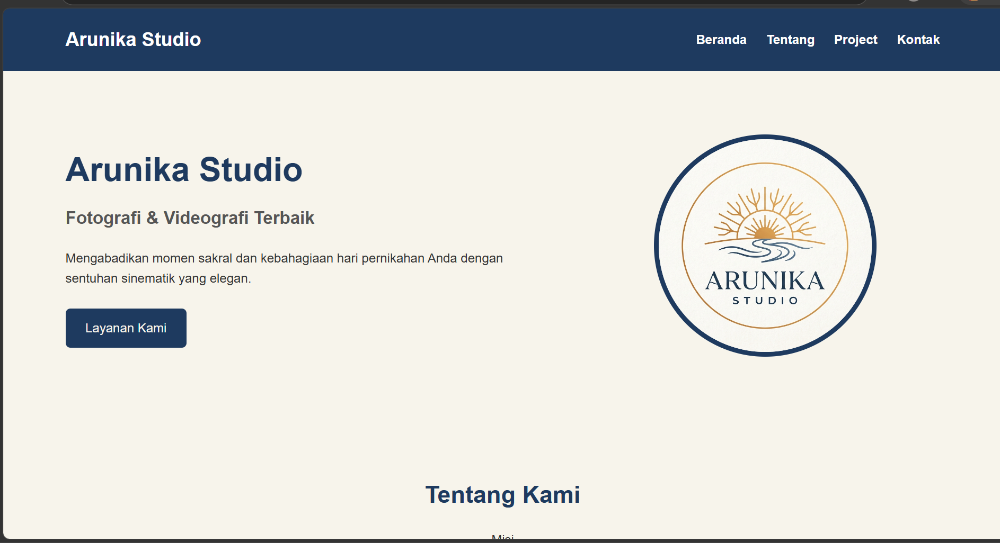
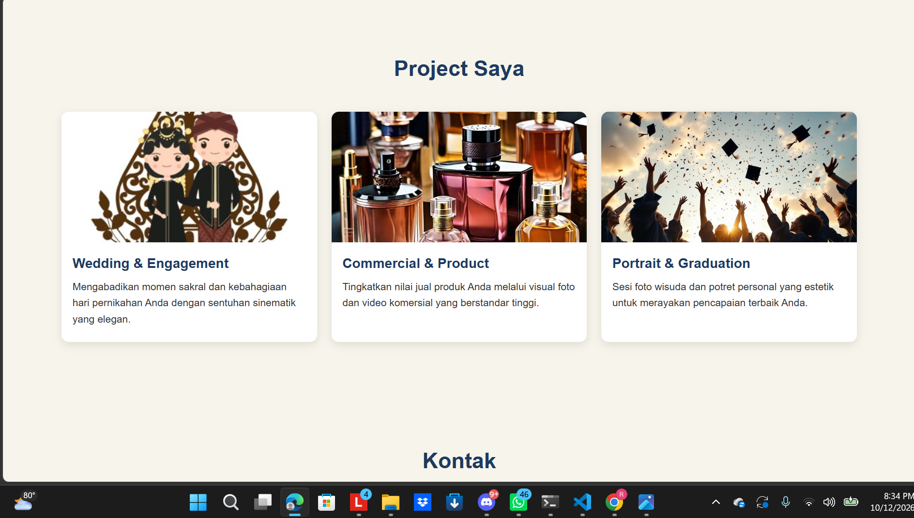
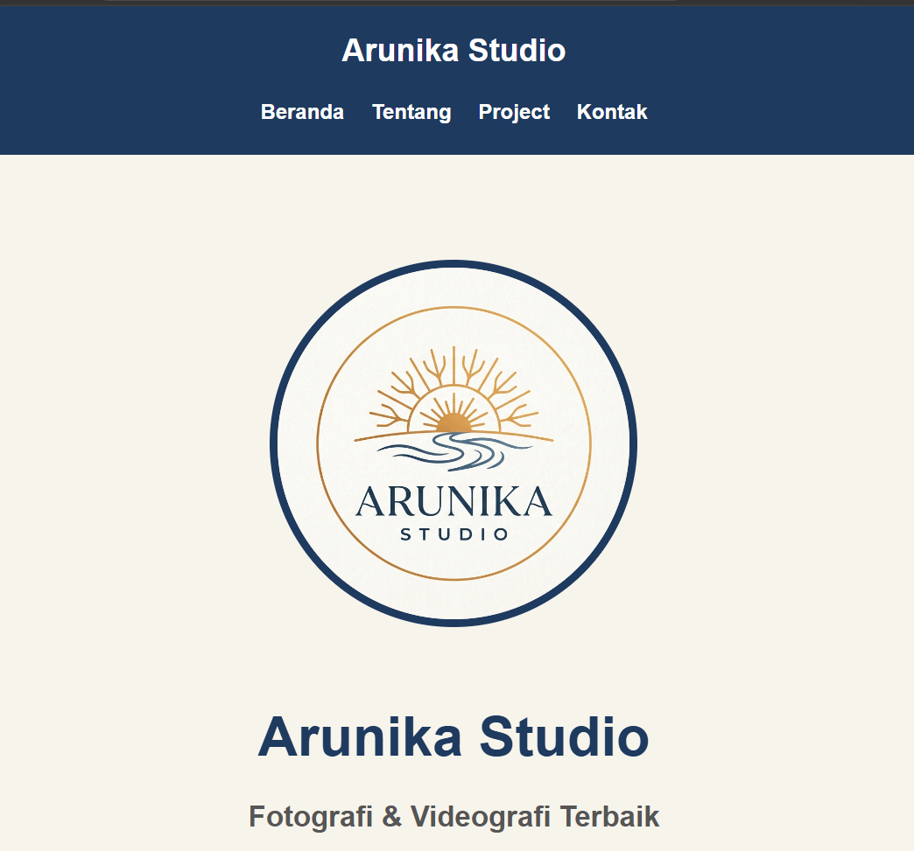
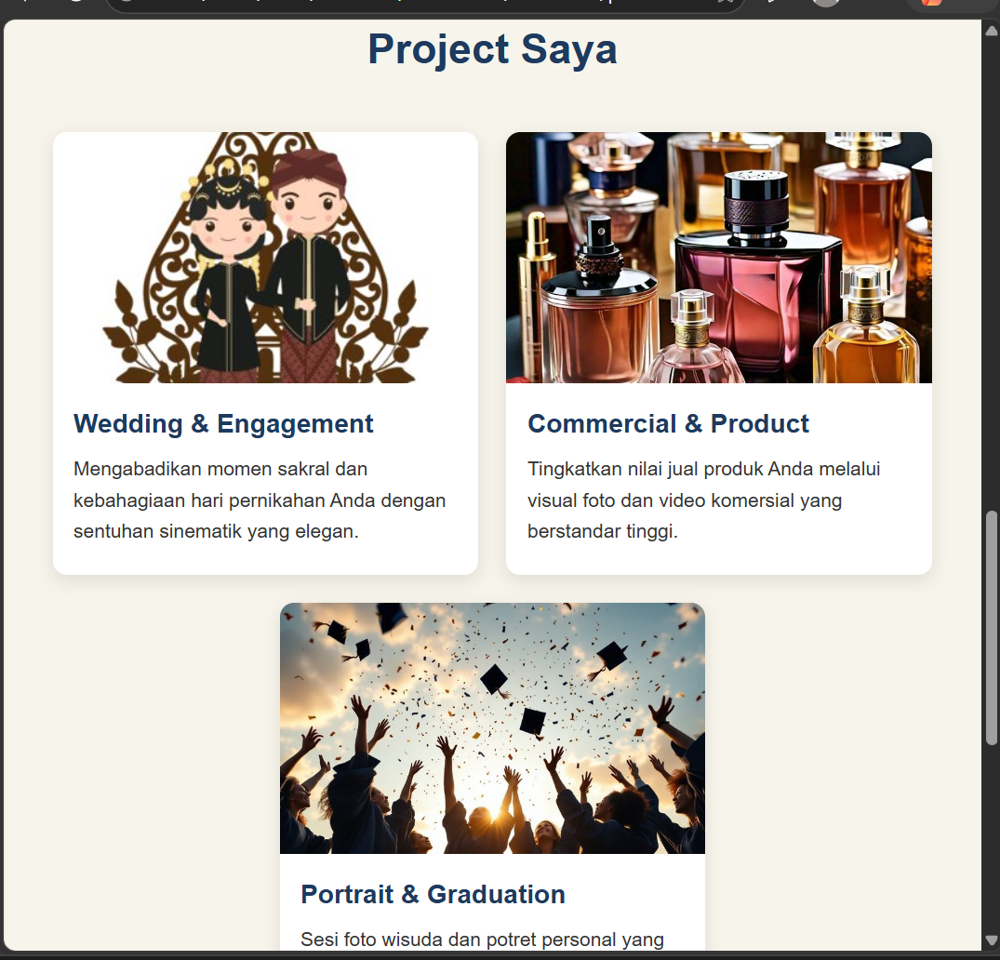

# 🌅 Landing Page - Arunika Studio

Proyek ini merupakan penugasan individu praktikum untuk membangun ulang halaman profil web menjadi *landing page* responsif berbasis HTML5 dan CSS3 untuk **Arunika Studio**.

---

## 📌 Deskripsi Proyek

Arunika Studio membutuhkan halaman *landing page* sederhana yang nyaman diakses melalui perangkat desktop maupun ponsel. Proyek ini memisahkan kode struktur dan tata letak secara bersih, menggunakan *box model*, kelas yang dapat digunakan kembali (*reusable class*), serta penerapan *media query* untuk responsivitas tampilan mobile.

## Before & After

### Berfore



### After




### 🌟 Fitur & Elemen Utama
* **Header & Navigasi:** Menampilkan logo dan menu navigasi yang responsif (*sticky header*).
* **Hero Section:** Banner utama dengan pesan ajakan bertindak (*call-to-action*) dan latar belakang visual.
* **Services Section:** 3 *card* layanan utama (Wedding & Engagement, Commercial & Product, Portrait & Graduation) yang dilengkapi dengan gambar proporsional.
* **Footer:** Informasi identitas studio, hak cipta, dan kontak resmi.

---

## 🛠️ Aturan Teknis Praktikum yang Terpenuhi

1. **Pemisahan File:** Struktur kode dipisah menjadi 2 file utama (`index.html` dan `style.css`) tanpa ada CSS yang tersebar di dalam HTML.
2. **Box Model:** Diterapkan secara eksplisit pada komponen `.service-card` (`padding`, `border`, `border-radius`, `box-shadow`) dan pemilih universal (`box-sizing: border-box`).
3. **Reusable Classes (Minimal 2):**
   * `.container`: Mengatur batas lebar maksimum dan pemusatan konten halaman secara konsisten.
   * `.btn`: Kelas dasar untuk styling tombol.
4. **Media Query (< 768px):** Mengubah tata letak 3 kolom `.services-grid` pada layar desktop menjadi **1 kolom vertikal** pada layar ponsel.

---

## 📂 Struktur Folder

```text
arunika-studio/
├── index.html        # Struktur markup HTML5
├── style.css         # Styling, tata letak, dan media query
└── README.md         # Dokumentasi proyek