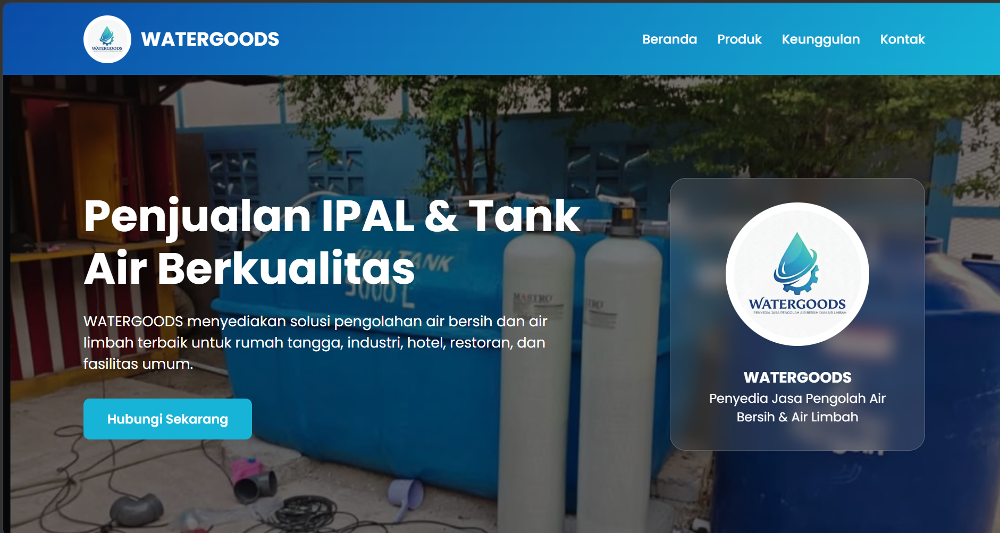
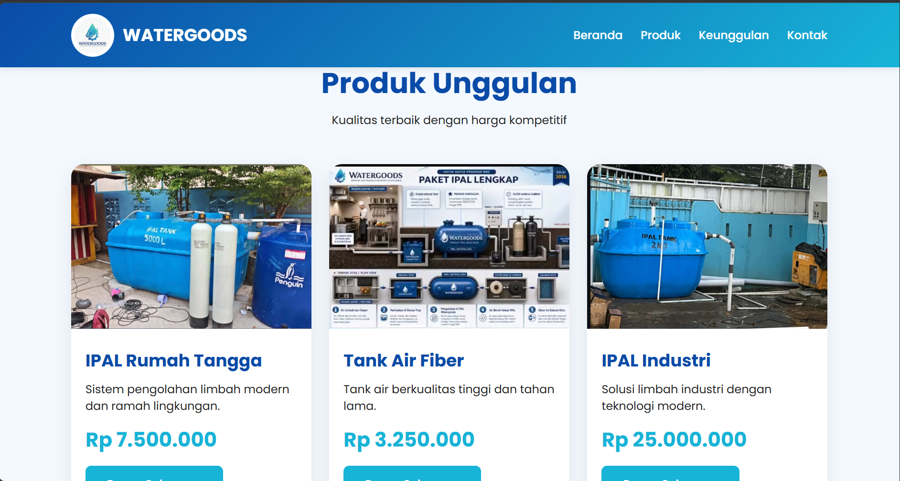
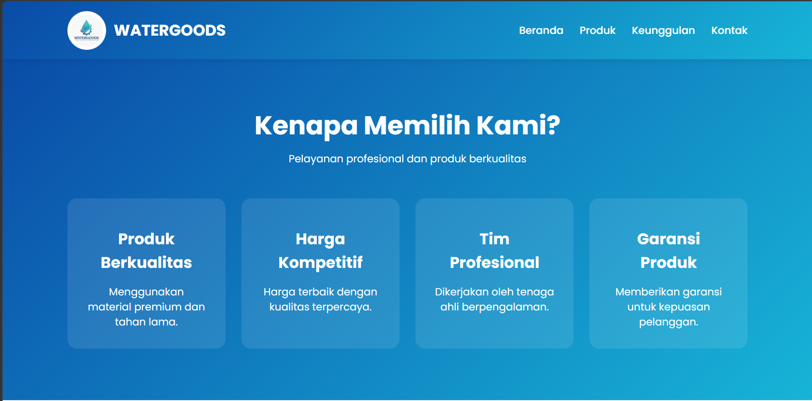
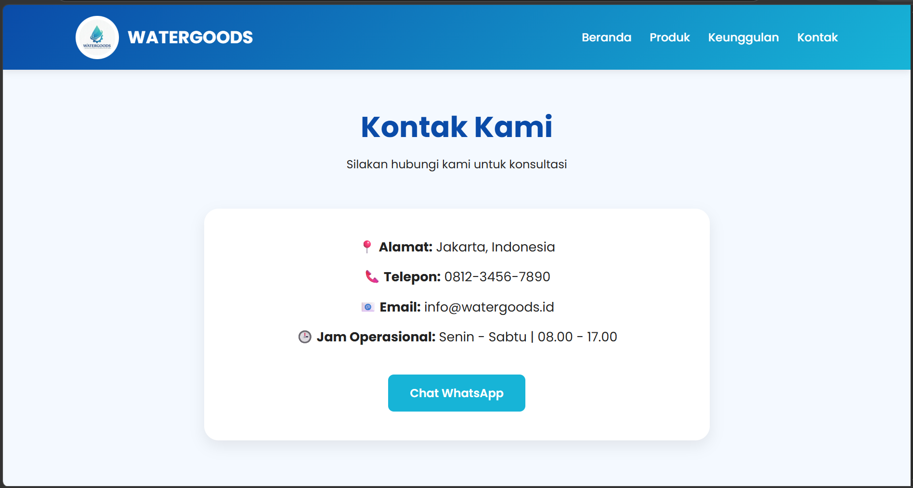
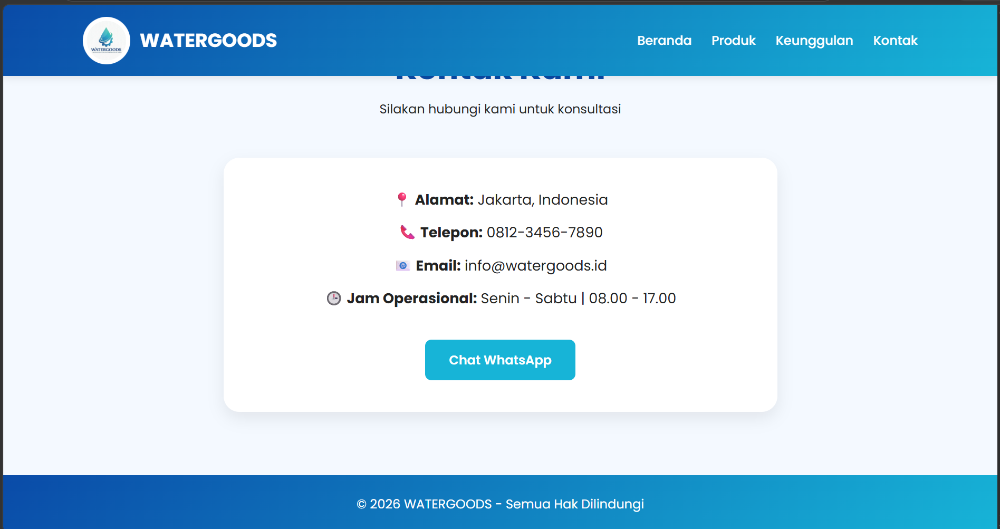

💧 Landing Page - WATERGOODS

Proyek ini merupakan penugasan individu praktikum untuk membangun ulang halaman profil web menjadi landing page responsif berbasis HTML5 dan CSS3 untuk WATERGOODS.

📌 Deskripsi Proyek

WATERGOODS membutuhkan halaman landing page sederhana yang nyaman diakses melalui perangkat desktop maupun ponsel untuk menawarkan solusi pengolahan air bersih (IPAL) dan tangki air. Proyek ini memisahkan kode struktur dan tata letak secara bersih, menggunakan box model, kelas yang dapat digunakan kembali (reusable class), serta penerapan media query untuk responsivitas tampilan mobile.

Tampilan:

🌟 Fitur & Elemen Utama

Header & Navigasi: Menampilkan logo WATERGOODS dan menu navigasi responsif (sticky header).

Hero Section: Banner utama berlatar visual dengan tombol ajakan bertindak (call-to-action) menuju WhatsApp dan kartu profil visual.

Products Section: 3 card produk unggulan (IPAL Rumah Tangga, Tank Air Fiber, IPAL Industri) yang dilengkapi dengan gambar, rincian harga, serta tombol pemesanan.

Features Section: Panel keunggulan layanan dengan latar belakang gradien biru.

Contact & Footer: Informasi kontak resmi, alamat, jam operasional, tautan WhatsApp, dan hak cipta.

🛠️ Aturan Teknis Praktikum yang Terpenuhi

Pemisahan File: Struktur kode dipisah menjadi 2 file utama (index.html dan style.css) tanpa ada CSS terselubung di dalam HTML.

Box Model: Diterapkan secara eksplisit pada komponen .card, .hero-card, .feature-box, dan .contact-box (padding, margin, border-radius, box-shadow) serta pemilih universal (box-sizing: border-box).

Reusable Classes (Minimal 2):

.btn: Kelas dasar untuk pengayaan tombol aksi dengan efek transisi saat di-hover.

.section-title: Kelas serbaguna untuk mengatur tata letak, warna, dan perataan judul pada setiap bagian halaman.

Media Query (< 768px): Mengubah tata letak perataan pada hero section dan menyembunyikan navigasi menu agar tampilan optimal di layar ponsel.

📂 Struktur Folder

watergoods/
├── index.html        # Struktur markup HTML5
├── style.css         # Styling, tata letak, dan media query
├── README.md         # Dokumentasi proyek
└── images/           # Aset gambar proyek
    ├── watergood.jpg
    ├── hero-background.png
    ├── tank-air-fiber.png
    └── gambar_ipal.png
