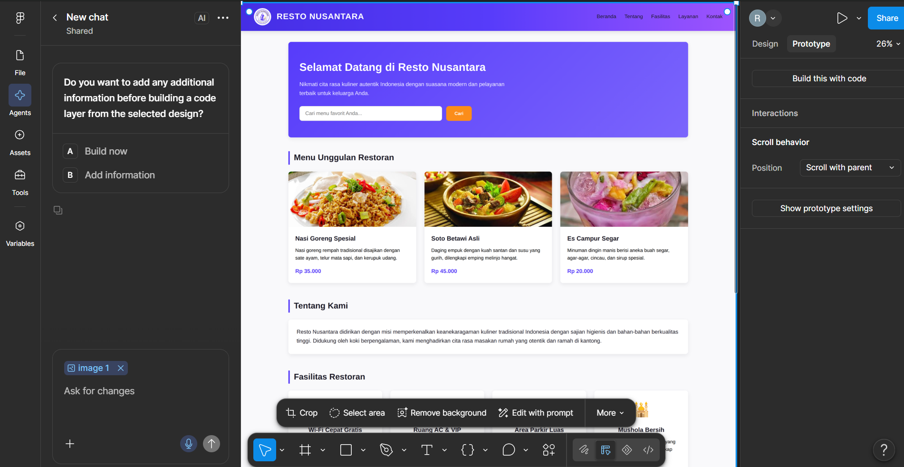
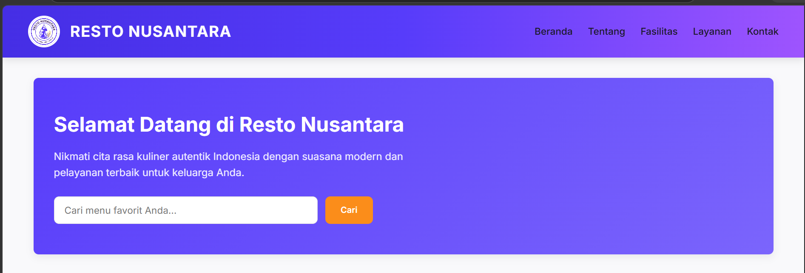
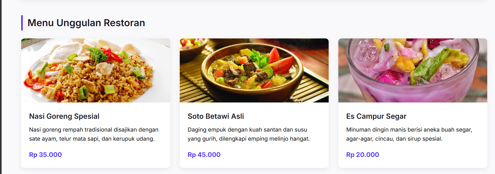

# 🍽️ Resto Nusantara - Website & UI/UX Design System

Selamat datang di repositori **Resto Nusantara**. Proyek ini merupakan aplikasi web profil restoran modern yang menyajikan keanekaragaman kuliner autentik Indonesia. Proyek ini mencakup perancangan sistem UI/UX di Figma serta implementasi antarmuka berbasis Web (HTML5 & CSS3).

---

## 🎨 UI/UX Design (Figma Space)

Berikut adalah ruang dokumentasi untuk rancangan UI/UX proyek Resto Nusantara.

###  Prototype & File Figma
> 📌 **Figma Canvas / Prototype:** 

### 🖼️ Preview Desain UI/UX

| Desktop Navigation & Hero | Menu Unggulan (Card Grid) |
| :---: | :---: |
| ![Desktop View Navbar] | ![Menu Cards] |

#### 📐 Design System Tokens
- **Primary Color:** `#573CFA` (Ungu Modern)
- **Secondary Color:** `#FB8D1A` (Oranye Aksentuasi)
- **Neutral Dark:** `#1C1A27`
- **Neutral Light:** `#F9F9FB`
- **Typography:** Font Family `'Inter', sans-serif`

---

## 🚀 Fitur Utama Website

1. **Header Navigation sticky:** Navigasi modern dengan logo restoran dan link ke seluruh seksi.
2. **Hero Banner:** Banner penyambung utama dilengkapi dengan kotak pencarian menu.
3. **Menu Unggulan:** Tampilan kartu (*card grid*) terstruktur untuk menu makanan dan minuman.
4. **Tentang Kami & Fasilitas:** Informasi keunggulan restoran beserta icon indikator visual.
5. **Kontak & Informasi Operasional:** Detail lokasi, jam operasional, dan kontak reservasi.
6. **Responsif Mobile:** Tampilan yang menyesuaikan otomatis di perangkat layar kecil/smartphone.

---

## 📁 Struktur Folder Proyek

```text
Pertemuan 6/
┣ 📜 logorestonusantara.jpg
┣ 📜 images.jpg (Nasi Goreng)
┣ 📜 images (1).jpg (Soto Betawi)
┗ 📜 images (2).jpg (Es Campur)
┣ 📜 index.html
┣ 📜 style.css
┗ 📜 README.md
```

---

## 💻 Cara Menjalankan Proyek Secara Lokal

1. **Clone / Download** repositori ini ke komputer Anda.
2. Buka folder proyek menggunakan code editor (seperti **Visual Studio Code**).
3. Jalankan ekstensi **Live Server** pada file `index.html` atau cukup klik 2x file `index.html` untuk memuatnya langsung di browser web.

---

## 🛠️ Teknologi yang Digunakan

* **HTML5** - Struktur semantik halaman web.
* **CSS3** - Layouting dengan Flexbox & Grid, CSS Custom Variables.
* **Figma** - Perancangan UI/UX Mockup dan SVG Component.

---
© 2026 **Resto Nusantara** - Cita Rasa Indonesia.